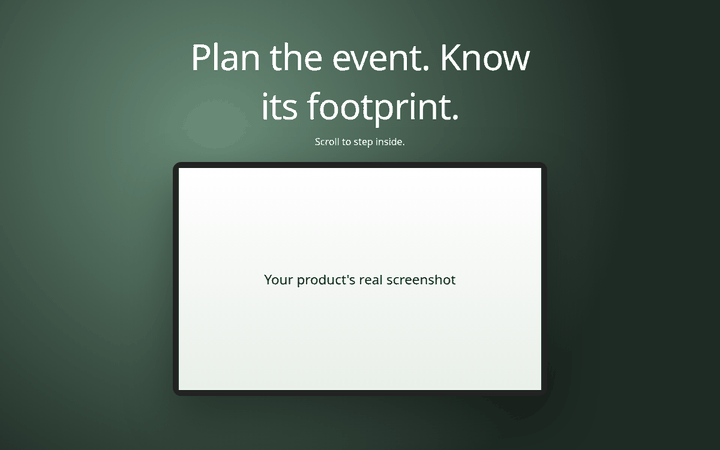

# scroll-driven-homepage

**Add a scroll-driven homepage to the product app you already have: real screens, no generated
media, production checks included.**

A Claude Code skill (also readable by any coding agent) distilled from shipping one for real:
pinned scenes that follow the scroll, a sentence written word by word, a camera dive into the
product's own screen, and timed product demos. No animation library: a ~150-line engine that
works in plain HTML, Angular, React, Vue or Svelte without re-rendering on scroll.



**[Try the live demo →](https://ecclesiaste-panda.github.io/skills/)** (scroll it; then turn on
"reduce motion" in your system settings and reload)

## Install

**Claude Code** (2.1.275 or later):

```
/plugin install scroll-driven-homepage --marketplace ecclesiaste-panda/skills
```

Older versions: `/plugin marketplace add ecclesiaste-panda/skills`, then
`/plugin install scroll-driven-homepage@ecclesiaste-panda`.

**By hand / other agents:** copy [`skills/scroll-driven-homepage`](skills/scroll-driven-homepage)
into your project's `.claude/skills/` (or your agent's skills folder). `SKILL.md` is plain
Markdown, so it also works as a guide you read yourself.

Then ask, for example: *"Our homepage is boring. Make it scroll like stripe.com, with a dive into
our dashboard."*

## What it does

The skill walks the agent (and you) through seven phases:

1. **Study the inspiration and mock it**: scenes described in words, a single-file mockup with
   real copy and real screenshots, a video sent to whoever decides. Get a yes before building.
2. **Plan**: check the mockup at 390 px first; one scene per phase, each reviewed.
3. **Engine**: one passive scroll listener, attached only while a scene is on screen; renders
   write styles directly, so your framework never re-renders while scrolling.
4. **Scenes**, one at a time, with reduced-motion and small-screen versions.
5. **Keep the real feature working** (the sign-up, search or form the homepage leads to).
6. **Restyle the rest** of the page; add nothing that wasn't approved.
7. **Polish and measure**: Lighthouse on the production build, scroll smoothness, link previews.

It ships with the engine, a cancellable demo player, a working example, a checklist (mobile,
reduced motion, accessibility, performance, tests) and notes for each framework, plus the list
of mistakes made the first time so you don't repeat them.

## How it differs from other scroll skills

There are good, more popular skills for building a new scroll-driven site from scratch:
[scroll-world](https://github.com/oso95/scroll-world) makes a 3D fly-through from AI-generated
video, [scroll-craft](https://github.com/nateherkai/scroll-craft) brings a full design workflow
and its own engine. This one is narrower: it brings scroll storytelling into **an existing
product's app**, with **the product's real screens**, through **an approval step with the
owner**, and with the checks that matter once it ships (zero re-renders per frame, keyboard and
screen-reader access, pause controls, Lighthouse).

## Single-file edition

Can't install a folder? There is an *essential* edition: the method and the engine in one
`SKILL.md`. [Open an issue](https://github.com/ecclesiaste-panda/skills/issues) to get it.

## Licence

MIT © 2026 Ecclesiaste Panda. Use it, change it, ship it; keep the notice.

---

<details>
<summary>For the maintainer: packing and signing</summary>

`./pack.sh <skill>` builds `dist/<skill>-<version>.zip` from the last commit (its `VERSION` file
gets the commit id and date) and signs it with my SSH key. When a skill has a `SKILL.lite.md`, it
also builds `dist/<skill>-<version>-essential.SKILL.md`, one self-contained file with the core
code inlined. To check a file came from me unchanged:

    ssh-keygen -Y verify -f allowed_signers -I ecclesiaste -n file -s <file>.sig < <file>

Nothing in this repo may contain client names, private notes, secrets, or code copied from a
client repo.
</details>
